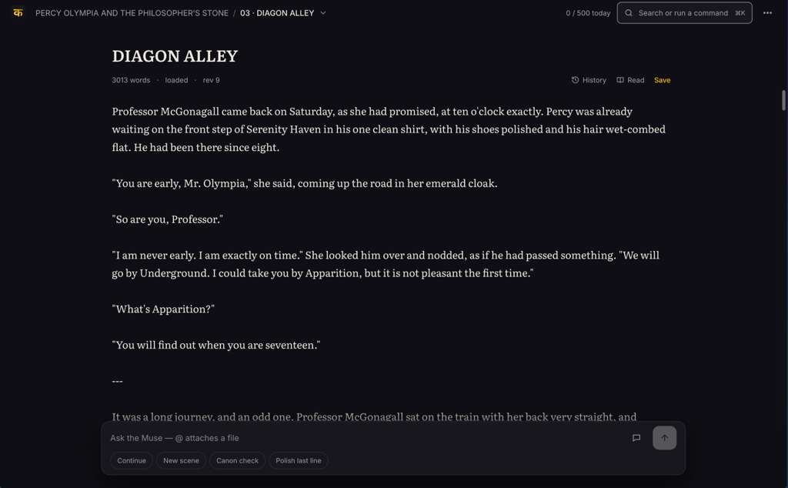
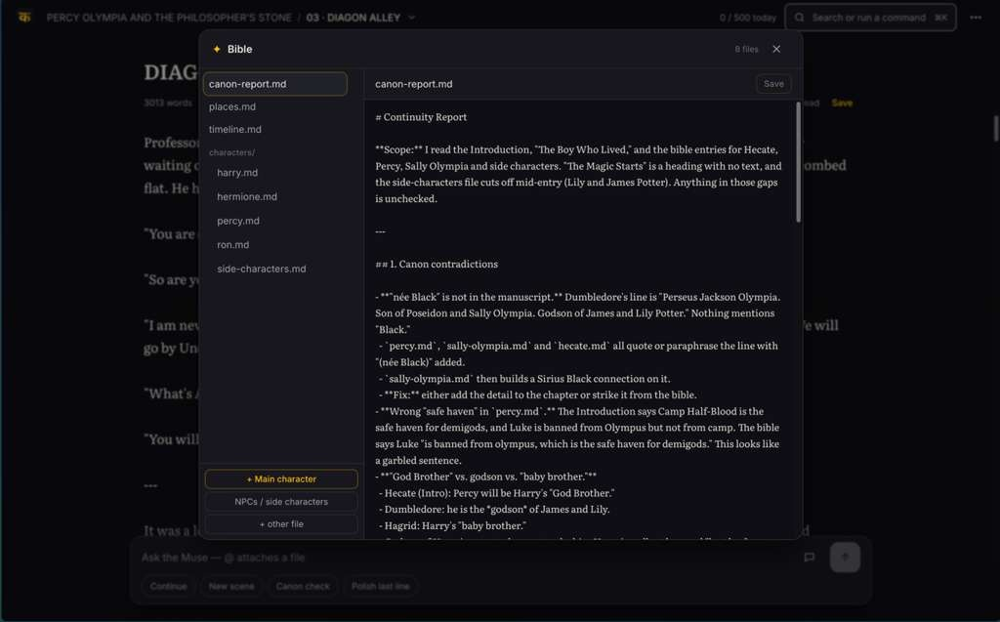

# Katha (कथा)

A self-hosted story-writing IDE. Three panes — the chapters, the page, the Muse — with an AI companion that reads your story's folder and edits your chapters and story bible the way a coding assistant edits files: every change is staged, shown to you hunk by hunk, and saved only when you accept it.

Built to be *yours*: no SaaS, no accounts on someone else's server. One FastAPI process on a
Raspberry Pi 5 serves **both** the API and an installable PWA, and the Markdown archive never leaves
the machine.

**Status:** 3.1 — see `STATUS.md`.



## What it does

| | |
|---|---|
| **Three-pane editor** | chapter tree · the page · the Muse, in one screen |
| **Markdown is the truth** | `series/book/chapters/*.md` on disk; the database is a rebuildable index, never the source of truth |
| **Muse** | rewrite a draft into novel prose, continue a scene, or write in a named character's voice |
| **Continuity report** | cross-checks the manuscript against the story bible and reports contradictions with quoted passages |
| **Bible** | character/world entries (`bible/`) that the Muse reads before it writes |
| **Revisions & hunk review** | every AI proposal arrives as hunks you accept or reject — nothing lands on the page unreviewed |
| **Covers & archive** | per-book covers, soft delete, and a plain folder you can `git init` or zip |
| **Installable PWA** | one React codebase for desktop and mobile, offline-capable shell |



## Stack

| Layer | Choice |
|---|---|
| Client | Installable **PWA** — React 18 + Vite + Tailwind, desktop **and** mobile, one codebase |
| Backend | FastAPI + SQLite (index only) + Markdown archive on disk |
| AI routing | **Ollama** on a LAN box, any OpenAI-compatible gateway, or a Messages-shape gateway (`KATHA_MUSE_API`) — no cloud account needed |
| Host | Raspberry Pi 5, Docker Compose, `tailscale serve` for the HTTPS origin a PWA needs |
| Storage truth | `series/book/chapters/*.md` + `bible/` — portable, git-able |

## Quick start

```bash
# on the Pi — serves the API and the built PWA on one port
cd server
docker compose up -d

# HTTPS origin so the PWA is installable (service workers need a secure context)
tailscale serve --bg https / http://localhost:4901
```

Open the served URL and use **Install app** in the browser (desktop and phone both work).

### Dev

```bash
# server — one port serves the API (and the built PWA, when it exists)
cd server
python3 -m venv .venv && . .venv/bin/activate   # Windows: .venv\Scripts\activate
pip install -r requirements.txt
python seed.py                                 # sample archive; skip for an empty one
uvicorn app.main:app --reload --port 4901

# client — :5173, proxies /api → :4901
cd desktop && npm install && npm run dev
```

## Tests

```bash
cd server && python -m pytest -q     # 207 tests
```

The suite covers the archive index, auth, covers, deletes, hunk application, Muse proposals,
prose rewriting, resume state and upstream routing — all against a temporary archive, with the model
call stubbed, so it runs offline.

## Docs

- `PROJECT.md` — architecture, components, API contract
- `DECISIONS.md` — every settled call and why
- `ROADMAP.md` — phases 0.0 → 2.0
- `STATUS.md` — where the quest stands
